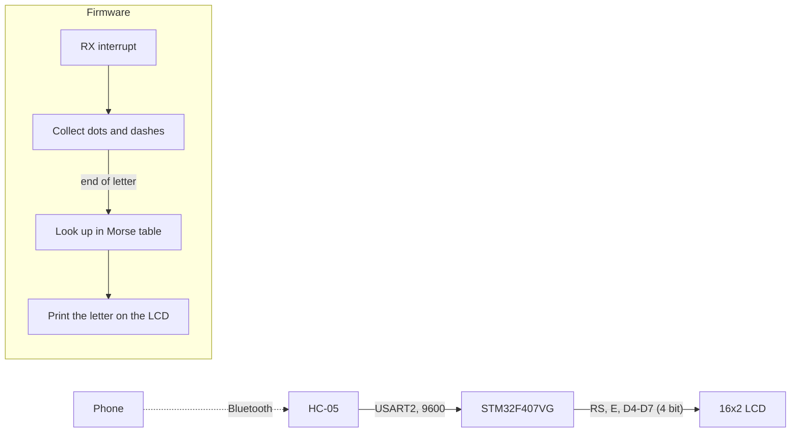

# Bluetooth Morse decoder with a character LCD

STM32F407 · HC-05 · HD44780 16x2 LCD

   [](https://tech-ohm.com)

**English** | [Türkçe](README.tr.md) · An open-source project by [TECH-OHM](https://tech-ohm.com)

Firmware that takes Morse symbols (dots and dashes) sent from a phone over Bluetooth, turns them into letters and prints them on a 16x2 LCD. On the phone, a simple two-button app or any Bluetooth serial terminal is enough.

## Block diagram



## Pins

| MCU pin | Connects to | Notes |
|---|---|---|
| PA2 | HC-05 RXD | USART2 TX, 9600 |
| PA3 | HC-05 TXD | USART2 RX |
| PA6 | LCD RS | |
| PA7 | LCD E | |
| PA8 | LCD D4 | |
| PA9 | LCD D5 | |
| PA10 | LCD D6 | |
| PA4 | LCD D7 | |

LCD RW is tied to ground. The V0 pin needs a 10k trimmer for contrast.

## Protocol

The phone sends three characters:

| Character | Meaning |
|---|---|
| `.` | dot |
| `-` | dash |
| `&` | end of letter |

To write `SOS`, send:

```
...&---&...&
```

For a space between words, send a single space character followed by `&`.

Incoming bytes collect in a buffer inside the interrupt. When `&` arrives the buffer is looked up in the Morse table and the letter is passed to the main loop. Writing to the LCD happens in the main loop, because the LCD driver contains delays that should not run inside an interrupt.

The table covers letters, digits and common punctuation. An unknown sequence prints `?`. When both lines of the display are full, it clears and starts over.

## LCD driver

`Core/Src/lcd.c` is a short HD44780 driver in 4-bit mode. The pins are defined in `lcd.h`.

## Build

In STM32CubeIDE use `File > Import > Existing Projects into Workspace` and select this folder.

## Status

I added the line wrapping and have not re-tested on the board since.

## License

MIT. The STM32 HAL and CMSIS files under `Drivers` keep their own licenses.

## Author

M. Eyüb Can, embedded systems engineer and founder of [TECH-OHM](https://tech-ohm.com)

## About TECH-OHM

[TECH-OHM](https://tech-ohm.com) designs electronic boards and embedded software, from the first schematic to series production. We also run a 12-month embedded systems training program and consult for engineering teams.

Web: [tech-ohm.com](https://tech-ohm.com) · Email: info@tech-ohm.com
