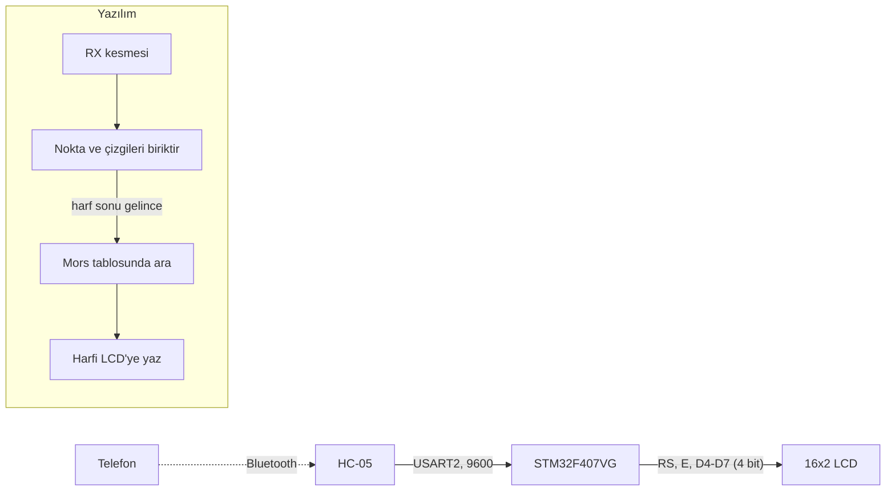

# STM32F407 ile Bluetooth üzerinden mors çözücü

> [TECH-OHM](https://tech-ohm.com) açık kaynak projesi

Telefondan Bluetooth ile gönderilen mors işaretlerini (nokta ve çizgi) harfe çevirip 16x2 LCD'ye yazan yazılım. Telefonda iki düğmeli basit bir uygulama ya da herhangi bir Bluetooth seri terminal yeterli.

## Blok diyagram



## Pinler

| Kart pini | Bağlandığı yer | Açıklama |
|---|---|---|
| PA2 | HC-05 RXD | USART2 TX, 9600 |
| PA3 | HC-05 TXD | USART2 RX |
| PA6 | LCD RS | |
| PA7 | LCD E | |
| PA8 | LCD D4 | |
| PA9 | LCD D5 | |
| PA10 | LCD D6 | |
| PA4 | LCD D7 | |

LCD'nin RW ucu toprağa bağlı, kontrast için V0 ucuna 10k trimpot gerekir.

## Protokol

Telefondan üç karakter gönderiliyor:

| Karakter | Anlamı |
|---|---|
| `.` | nokta |
| `-` | çizgi |
| `&` | harf bitti |

Örneğin `SOS` yazmak için gönderilecek dizi:

```
...&---&...&
```

Kelime arası boşluk için tek bir boşluk karakteri ve ardından `&` gönder.

Gelen baytlar kesme içinde bir tamponda birikiyor. `&` gelince tampon mors tablosunda aranıyor ve bulunan harf ana döngüye bildiriliyor. LCD'ye yazma ana döngüde yapılıyor, çünkü LCD sürücüsü içinde beklemeler var ve bunlar kesme içinde çalıştırılmamalı.

Tabloda harfler, rakamlar ve yaygın noktalama işaretleri var. Tabloda olmayan bir dizi gelirse ekrana `?` yazılıyor. Ekranın iki satırı dolunca temizlenip baştan başlıyor.

## LCD sürücüsü

`Core/Src/lcd.c` içinde HD44780 için 4 bit modda çalışan kısa bir sürücü var. Pinler `lcd.h` içinde tanımlı.

## Derleme

STM32CubeIDE'de `File > Import > Existing Projects into Workspace` ile klasörü seç.

## Durum

Satır kaydırmayı ekledikten sonra kartta yeniden denemedim.

## Lisans

MIT. `Drivers` klasöründeki STM32 HAL ve CMSIS dosyaları kendi lisanslarıyla gelir.

## Yazar

Gömülü Sistem Mühendisi M. Eyüb Can, [TECH-OHM](https://tech-ohm.com) kurucusu

## TECH-OHM

[TECH-OHM](https://tech-ohm.com) elektronik kart ve gömülü yazılım tasarlayan bir mühendislik firması. Fikirden seri üretime kadar tasarım işi alıyor, TECH-OHM Akademi'de 12 aylık gömülü sistem eğitimi ve şirketlere özel danışmanlık veriyor.

Web: [tech-ohm.com](https://tech-ohm.com) · E-posta: info@tech-ohm.com
